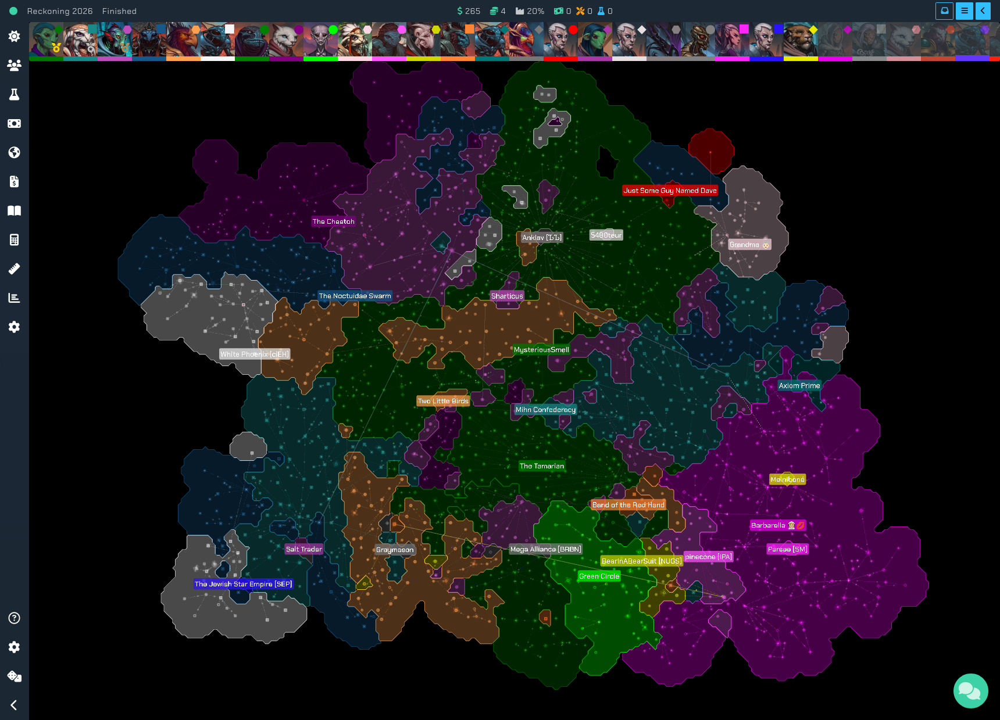

# Solaris

Solaris is a slow-burn browser game heavily inspired by [Neptune's Pride](https://np.ironhelmet.com) and [Subterfuge](http://subterfuge-game.com/).

- Build economic, industrial and scientific infrastructure to improve your empire.
- Build carriers to travel to new stars or to fight your enemies.
- Research new technologies to gain an edge over your opponents.
- Hire specialists which grant special abilities to stars and carriers like increased weapons and speed.
- Set up trade with your allies to get ahead of the curve.
- Play games with up to 64 players at a time.
- Participate in group chats with your allies to discuss strategy.
- Fight other players and capture stars to win the game.
- Games last around 2-3 weeks, and you don't need to commit a lot of time to play!
- Play on any device that has a web browser.
- It's completely free!

Visit [solaris.games](https://solaris.games) to play now!

## Running Solaris

Solaris requires at minimum NodeJS 24 and MongoDB 8.

### For Development

For development, it is recommended to run the actual servers locally for ease of debugging. 
However, a docker-based development workflow is also possible, although that means hot reloading is not supported out of the box.

*Note: it is recommended that you deactivate the Vue Devtools browser extension when developing Solaris unless strictly necessary. Otherwise, the size of the game state causes extreme slowdowns.*

#### Locally

You need a MongoDB instance for Solaris. With `docker compose -f docker-compose.requirements.yml up` you can start one.

1. `npm install`
2. `npm run build`
3. Copy `client/.env.example` to `client/.env` (and make adaptions if needed) 
4. Copy `server/.env.example` to `server/.env` (and make adaptions if needed)
5. In `server/`: `npm run start-api:dev` to start the API server
6. In `server/`: `npm run start-jobs:dev` to start the jobs processor
7. In `client/`: `npm run dev` to start the frontend dev server
8. Solaris is running on `http://localhost:8080/`(default)

#### With Docker

The images can be built by running `build-images.sh` in `docker/dev/`.

### In Production

For production usage Docker is the recommended way, although the server scripts can be called directly.

The file `docker-compose.prod.yml` provides an example for running Solaris in production using docker-compose.

The images can be built by running `build-images.sh` in `docker/prod/`.

### Database Migrations

Database migrations can be applied with the scripts `start-db-migrate:dev` / `start-db-migrate:prod`.
The database automatically tracks which migrations were applied and the script asks for confirmation.

## License
See [here](LICENSE).

## Contributing
See [here](CONTRIBUTING.md).

## Project Structure

`common/`: Common library, defines types and implements some logic, defines the API
`map-rendering/`: Map rendering implementation based on PixiJS
`api-client/`: Axios client to access the API
`client/`: Frontend
`server/`: API Backend and jobs processing
